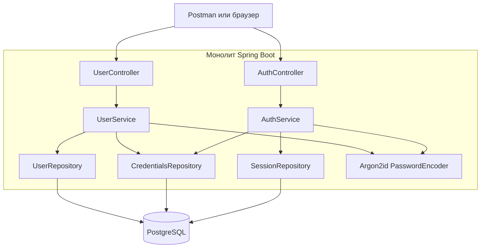
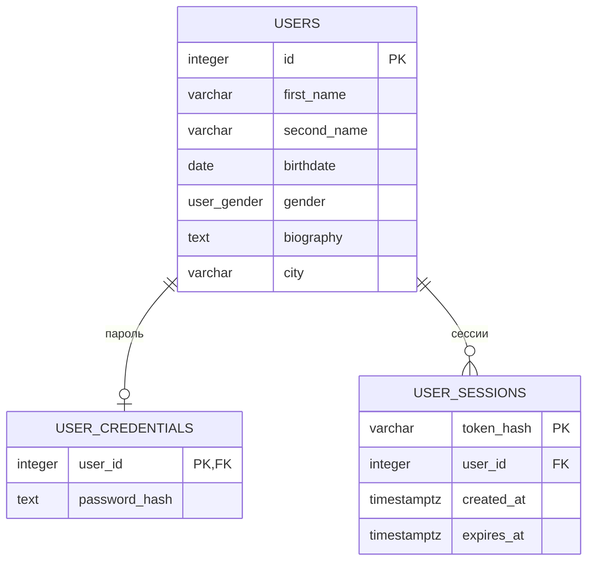
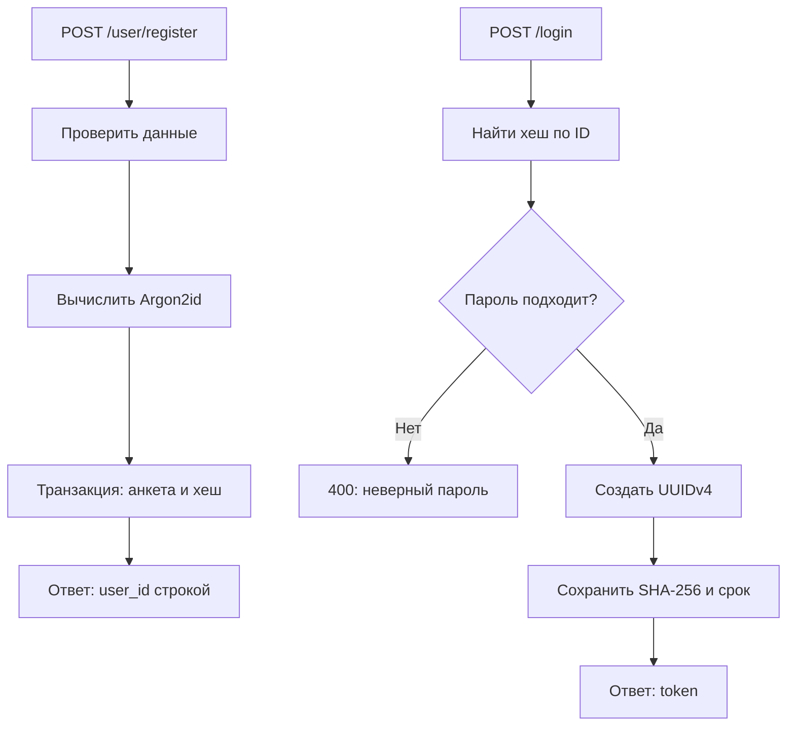

# Архитектура и сценарии

Один Java-процесс и PostgreSQL. Контроллеры отвечают за HTTP, сервисы — за сценарии и транзакции,
репозитории — за параметризованный SQL. Публичная модель анкеты не содержит данных для входа.
Spring Security подключён как модуль `spring-security-crypto`; автоматического требования
авторизации и браузерной формы входа нет.

## Таблицы

FK и PK допускают максимум одну запись пароля на пользователя. Наличие пароля у каждой созданной
анкеты обеспечивает транзакция регистрации. Гендер: MALE, FEMALE, UNSPECIFIED.

## Регистрация и вход

Не найден пользователь — 404. Невалидные данные — 400.
Получение `/user/get/{id}` обращается только к таблице users и не требует токена.

## Разделение секретов

- Анкета: только публичные поля.
- Пароль: соль и параметры входят в строку Argon2id.
- Токен: UUID у клиента, SHA-256 в БД.
- Поиск сессии: хеш токена и проверка `expires_at`; результат — постоянный integer ID.

Публичное имя, друзья, посты и сообщения могут быть добавлены дальнейшими миграциями.
