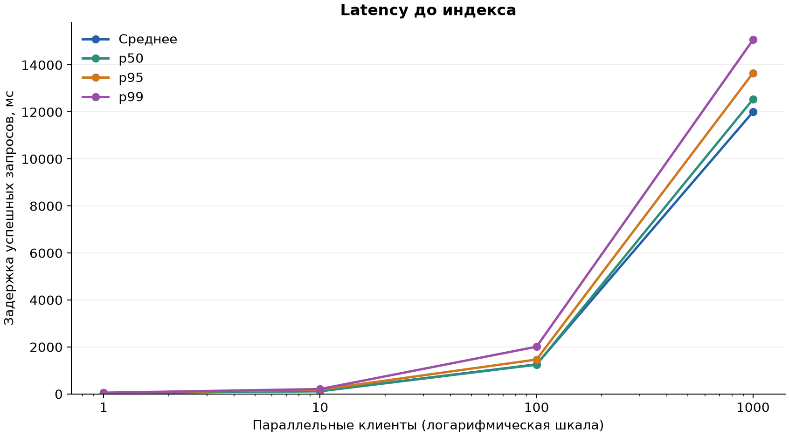
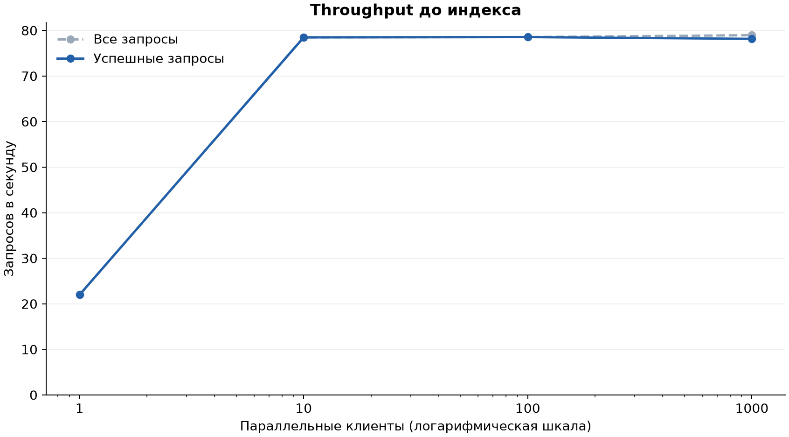
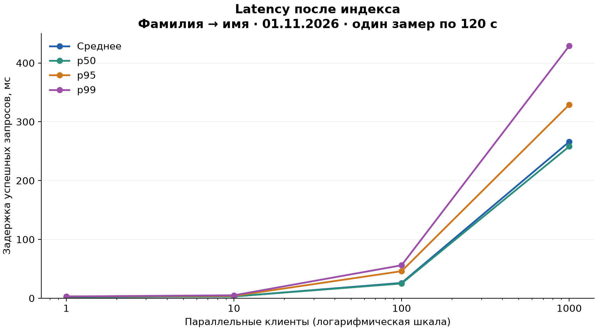
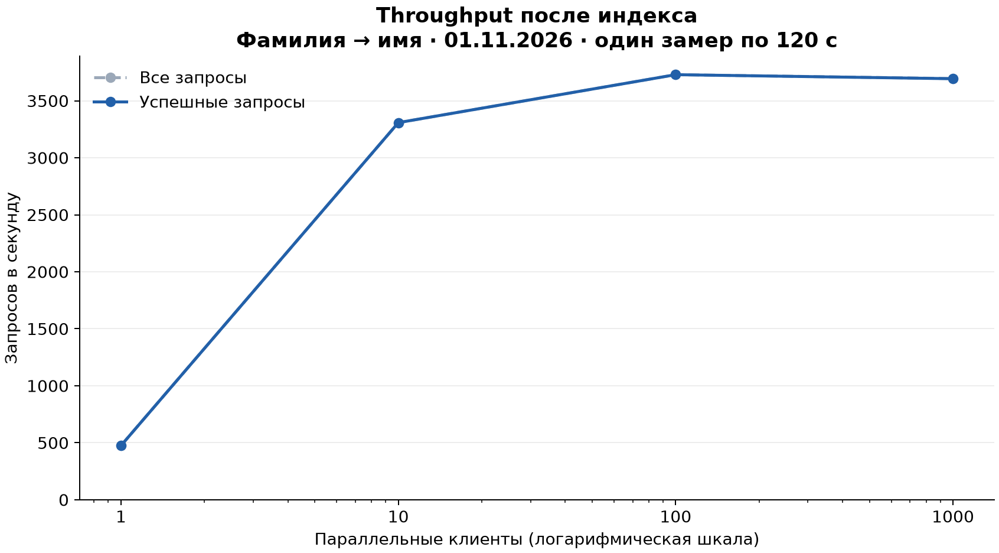

# Влияние индексов на поиск анкет

## Методология

Стенд: Java 21, Spring Boot 4.1.1, Spring JDBC, PostgreSQL 17.11 и Gatling 3.16.0. Приложение запущено через Run в IDEA без Debug и ограничения JIT; БД — в Docker. Всё работает на одном ПК: Ryzen 7 3700X, 8 ядер / 16 потоков, 32 ГиБ RAM. Пул HikariCP неизменен: максимум 10 соединений, минимум 2 свободных, ожидание до 5000 мс.

В базе 1 000 000 анкет. Из списка OTUS выделены 138 реальных имён и 1006 фамилий; они выбирались независимо и равновероятно. Возраст при генерации — 20–50 лет. Данные между замерами не менялись.

```http
GET /user/search?first_name=Ив&second_name=Ив
```

Оба префикса проверяются одновременно, выдача сортируется по числовому id и содержит 14 анкет. Закрытая модель нагрузки: постоянное число клиентов, следующий запрос сразу после ответа, без пауз. Проверки: HTTP 200 и JSON-массив; таймаут — 30 секунд. HTTP latency включает ожидание соединения с БД.

Сначала проверены база без поискового индекса и пять кандидатов: **100 клиентов × 60 секунд**. Перед каждой конфигурацией — прогрев 1 клиент × 30 секунд, ANALYZE и два EXPLAIN; сохранён второй план. Индексы первичных ключей сохранялись, поисковые индексы переключались по одному набору. Два близких лидера дополнительно проверены ещё по два раза.

Для победителя выполнена финальная серия: **1, 10, 100, 1000 клиентов, ровно один замер по 120 секунд на уровень**. Перед всей серией — один прогрев 1 × 30 секунд, без включения в результаты. Запуск из load-testing/gatling: `gatling:test -Dusers=N -Dduration=120`. Длительность задаёт подачу нагрузки; начатые запросы завершаются после её окончания. RPS и latency взяты из итоговой таблицы Gatling, колонка OK; время SQL — из EXPLAIN.

## Сравнение кандидатов: 100 × 60 секунд

| Вариант | OK RPS | p95, мс | SQL EXPLAIN, мс | Индексы, МиБ |
|---|---:|---:|---:|---:|
| Без поисковых индексов | 79,69 | 1315 | [47,937](explain.md#no-search-index) | 0,00 |
| B-tree: имя → фамилия | 3 444,65 | 50 | [0,298](explain.md#btree-name-surname) | 13,50 |
| **B-tree: фамилия → имя** | 3 598,17 | 48 | [0,235](explain.md#btree-surname-name) | 13,50 |
| Два отдельных B-tree | 1 971,48 | 85 | [1,553](explain.md#two-btree-indexes) | 13,88 |
| B-tree только по фамилии | 1 911,44 | 73 | [5,298](explain.md#btree-surname-only) | 7,08 |
| GIN с pg_trgm | 2 218,28 | 73 | [2,305](explain.md#gin-trgm) | 37,08 |

Во всех шести замерах ошибок нет. Размер указан без первичных индексов. [Все показатели и повторы](candidate-measurements.csv), [полные EXPLAIN](explain.md), [SQL пяти кандидатов и базового варианта](../../scripts/index-candidates/README.md).

## Выбранный индекс

```sql
CREATE INDEX users_surname_name_prefix_idx
    ON users (second_name varchar_pattern_ops, first_name varchar_pattern_ops);
```

В трёх проверках медиана RPS составила **3583,68** для «фамилия → имя» и **3444,65** для «имя → фамилия»: преимущество **4,04%**. p95 — 48 и 50 мс соответственно; оба индекса занимают 13,50 МиБ.

Префикс фамилии отбирает 1978 анкет, имени — 7220. Более избирательная фамилия стоит первой и сужает ведущий диапазон B-tree. План использует Index Scan и сортирует 14 найденных строк; счётчик shared hit — 24 против 32 у обратного порядка. Два отдельных B-tree требуют BitmapAnd, индекс только по фамилии дополнительно фильтрует имя, а GIN на этом коротком префиксе медленнее и больше.

Изменение оформлено [следующей миграцией Liquibase](../../../src/main/resources/db/changelog/003-user-search-surname-first.sql), чтобы сохранить историю уже применённой миграции. [План после её применения](explain.md#план-победителя-после-миграции).

## Финальная серия для победителя: один замер на уровень

| Клиентов | Запросов | OK RPS | Среднее, мс | p95, мс | p99, мс | Ошибок |
|---:|---:|---:|---:|---:|---:|---:|
| 1 | 57 042 | 475,35 | 2 | 3 | 3 | 0 |
| 10 | 397 011 | 3 308,43 | 3 | 4 | 5 | 0 |
| 100 | 451 229 | 3 729,17 | 26 | 46 | 56 | 0 |
| 1000 | 447 098 | 3 693,83 | 266 | 329 | 429 | 144 |

[Исходные показатели CSV](final-measurements.csv).

На уровне 1000 клиентов Gatling зарегистрировал 144 ошибки (0,032%): `SocketException: Permission denied: getsockopt`. Это ошибка сокета на стороне генератора нагрузки, а не HTTP 503; её точная причина в этом прогоне не установлена. Замер сохранён без повторного запуска. Latency в таблице и на графике относится к успешным запросам.

## Графики

**До индекса:** сохранена предыдущая серия от 31.10.2026 — три замера по 120 секунд на уровень. **После индекса:** новая серия от 01.11.2026 — один замер по 120 секунд на уровень для «фамилия → имя». Число анкет и параметры пула те же; число повторов различается.









## Вывод

Для выбранных префиксов лучший результат дал составной B-tree «фамилия → имя». В сравнении 100 × 60 он увеличил успешный throughput примерно в **45 раз** относительно базы без поискового индекса. В финальной серии при 1000 клиентах получено **3 693,83 запроса/с**, p95 — **329 мс**, с 144 ошибками сокета у генератора нагрузки. На уровнях 1, 10 и 100 клиентов ошибок нет. Переход от 100 к 1000 клиентам почти не изменил throughput, но увеличил среднюю задержку с 26 до 266 мс. Выбор относится к этому стенду и сочетанию префиксов; для других запросов порядок колонок может оказаться менее выгодным.

Во всех измерениях сохранён миллион исходных анкет. MD5 содержимого users: `1efc85f6988fd5eb24d2e22d70ec97eb`.
